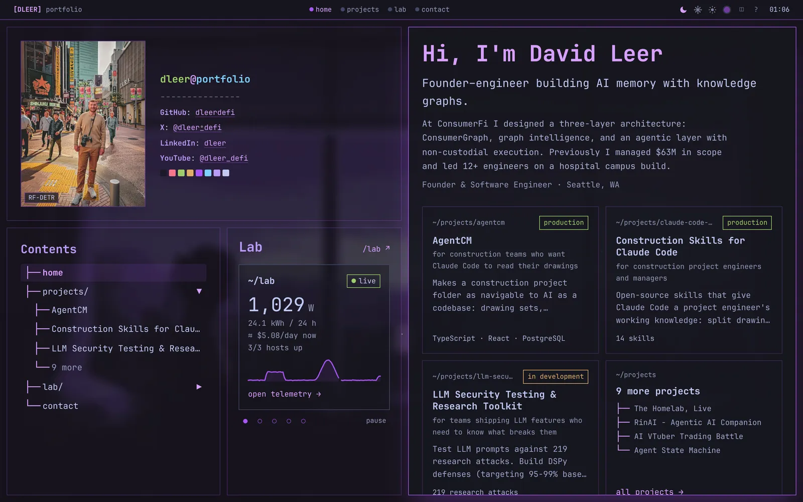
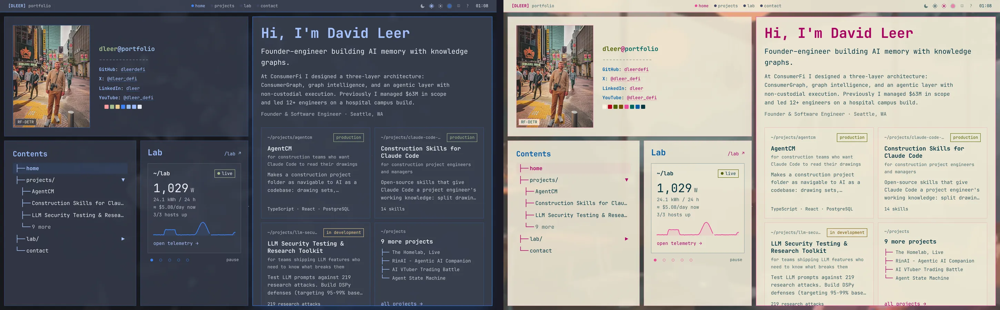
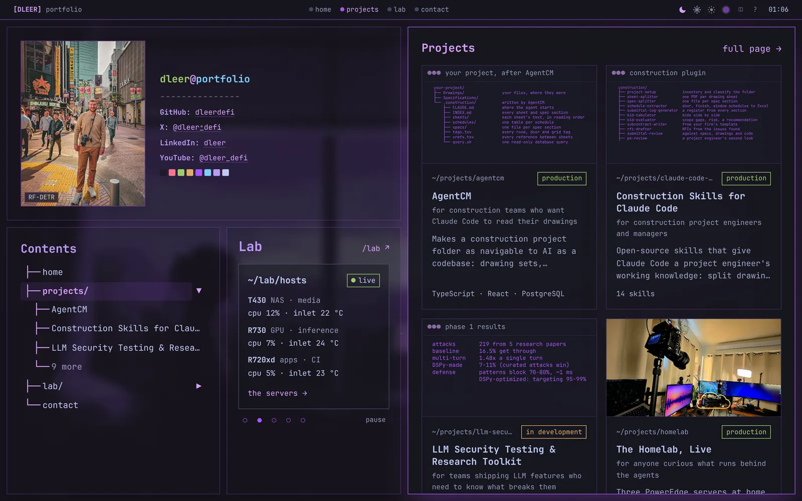
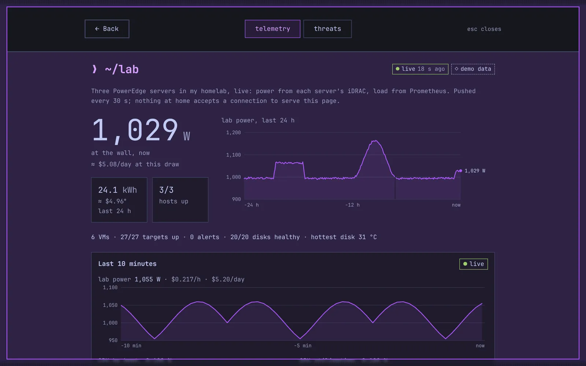
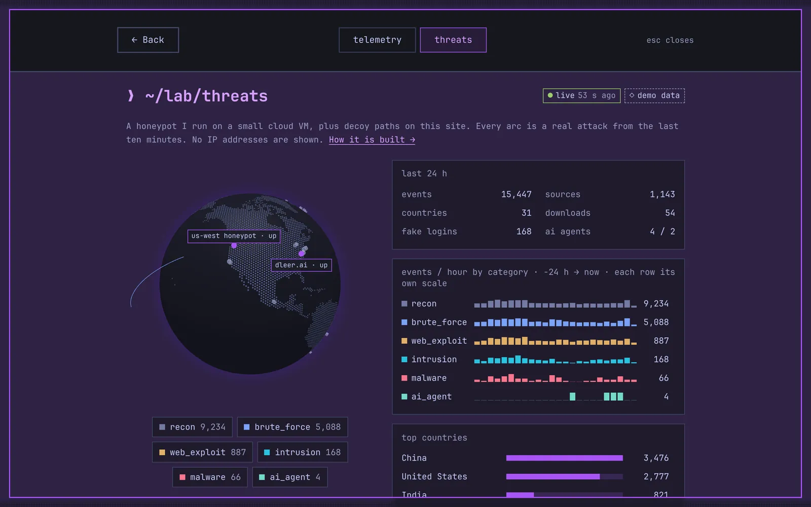
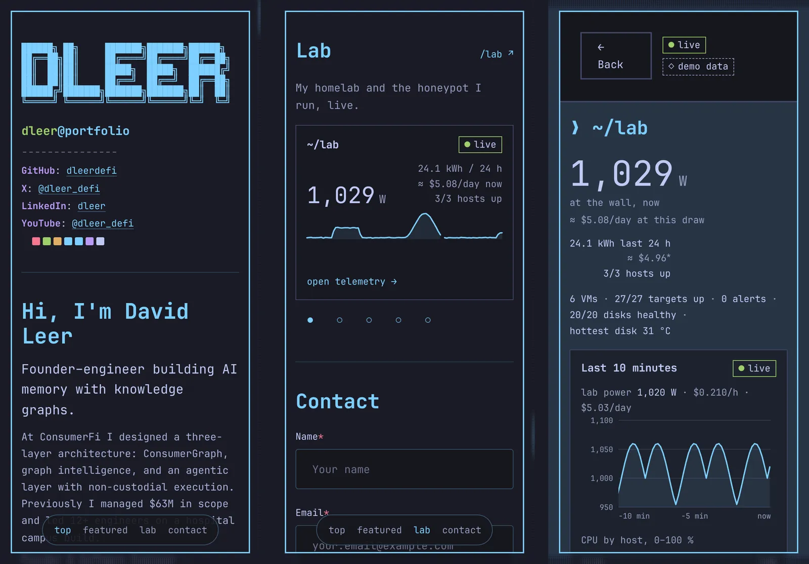

# David Leer's Portfolio

<div align="center">


A developer portfolio built with Next.js 15, laid out like a tiled Hyprland/Arch Linux desktop.
Projects are told as case studies, and `~/lab` shows my homelab live: power, load and GPUs from
three PowerEdge servers, and a honeypot's attacks on a 3D globe. The home page is server-rendered
once and laid out by CSS: tiles on desktop, one scrolling column on phones. Deployed on Railway.

[dleer.ai](https://dleer.ai) • [The homelab behind ~/lab](https://github.com/dleerdefi/dleer-homelab) • [Report Issue](https://github.com/dleerdefi/dleer-portfolio/issues)

</div>



---

## 📸 Screenshots

**Three presets, fifteen accents.** Tokyo Night (above), Nord and Solarized Light; every text color is measured at 4.5:1 or better over every wallpaper.



**Projects in the stage.** `projects/` in the contents tree or the polybar shows every project on the right, without leaving the page.



**`~/lab`: the homelab, live.** Power at the wall and what it costs at the current draw, 24 h charts, and a chart of the last 10 minutes that moves as new points arrive.



**`~/lab/threats`: the honeypot.** Every arc is an attack from the last few minutes, replayed on a 3D globe, with 24 h statistics by category and country. No IP address is ever shown.



**On phones.** One column: the profile, the featured projects, the lab card and contact, with a bar of section names to jump between them.



*The lab screenshots use the bundled demo data (`LAB_DEMO_DATA=true`), so they show the "demo data" badge.*

---

## ✨ Features

- **Desktop layout**: Hyprland-style tiles (neofetch with the profile photo, the contents tree, the stage, the lab card) and a polybar with workspaces, the theme tray and a clock
- **One DOM, two layouts**: `/` is server-rendered once; CSS makes it tiles from 1024 px and one scrolling column below, with a section bar and CSS scroll-driven depth on phones
- **Keyboard**: hjkl between tiles, native Tab, Esc back home, j/k in lists; keyboard focus looks like hover (a tint and the hover color), never a box
- **Theme system**: Tokyo Night, Nord and Solarized Light, 15 accents, wallpapers; text contrast measured from rendered pixels (`docs/audit/contrast.mjs`)
- **Projects as case studies**: MDX with frontmatter for the audience, status, metrics (GitHub stars read at build) and links; generated text covers when there is no hero image
- **`~/lab` (optional)**: live homelab telemetry and a honeypot threat map, read from documents the homelab pushes (see [Lab](#lab-optional))
- **Blog**: MDX posts with syntax highlighting, reading time and audio narration; `NEXT_PUBLIC_FEATURE_BLOG=false` keeps them as an archive, out of the navigation
- **Contact form**: Resend with layered spam protection (honeypot field, rate limiting, validation)
- **Open Graph cards**: generated at build time for the site, every project, post and the lab
- **Performance**: self-hosted subset fonts, pre-blurred wallpapers, no animation library; Lighthouse 100 on desktop

---

## 🚀 Quick Start

### Prerequisites

```bash
node >= 22
npm >= 10
```

### Setup

```bash
# Clone and install
git clone https://github.com/dleerdefi/dleer-portfolio.git
cd dleer-portfolio
npm install

# Configure environment
cp .env.example .env.local
# Edit .env.local with your RESEND_API_KEY and NEXT_PUBLIC_CONTACT_EMAIL

# Run development server
npm run dev
```

Visit **http://localhost:3000**

### Build Commands

```bash
npm run build      # Production build
npm run start      # Start production server
npm run typecheck  # TypeScript validation
npm run lint       # Code linting
npm test           # Unit tests (Vitest)
```

---

## ⚙️ Configuration

### Environment Variables

Create `.env.local` from template and configure:

| Variable | Required | Description |
|----------|----------|-------------|
| `RESEND_API_KEY` | ✅ Yes | Resend API key ([resend.com](https://resend.com) - free: 100 emails/day, 3K/month) |
| `RESEND_FROM_EMAIL` | ✅ Yes | Verified domain email for Resend (e.g., `contact@dleer.ai`) |
| `NEXT_PUBLIC_CONTACT_EMAIL` | ✅ Yes | Email address to receive form submissions |
| `NEXT_PUBLIC_CDN_URL` | Optional | Cloudflare R2 CDN URL (e.g., `https://cdn.dleer.ai`) |
| `NEXT_PUBLIC_NAME` | Recommended | Your full name |
| `NEXT_PUBLIC_TITLE` | Recommended | Your professional title |
| `NEXT_PUBLIC_GITHUB_URL` | Recommended | GitHub profile URL |
| `NEXT_PUBLIC_LINKEDIN_URL` | Optional | LinkedIn profile URL |
| `NEXT_PUBLIC_TWITTER_URL` | Optional | Twitter/X profile URL |
| `NEXT_PUBLIC_BIO_INTRO`, `NEXT_PUBLIC_BIO_SUMMARY` | Recommended | The one-line pitch and the short bio on the home page |
| `NEXT_PUBLIC_FEATURE_BLOG` | Optional | `false` keeps the blog as an archive, out of the navigation |

A social row (GitHub, X, LinkedIn, YouTube, Instagram, TikTok) shows in the neofetch tile only when its URL is set.
See [.env.example](.env.example) for the complete list.

### CDN Configuration (Optional)

This project supports **Cloudflare R2** for image hosting:

**Without CDN** (default):
- Images served from `/public/images/`
- Works out-of-the-box, no setup required

**With CDN** (recommended for production):
- Images served from Cloudflare R2
- Faster load times, reduced server bandwidth
- See [CLAUDE.md - Image Storage](CLAUDE.md#image-storage-cdn-configuration) for setup guide

**Quick Setup:**
1. Create Cloudflare R2 bucket
2. Upload images maintaining `/images/` folder structure
3. Connect custom domain (e.g., `cdn.dleer.ai`)
4. Set `NEXT_PUBLIC_CDN_URL` in environment variables
5. Deploy - images automatically load from CDN!

### Lab (Optional)

`~/lab` adds two live views of a homelab: **telemetry** (the servers' power at the wall and its
cost, load, temperatures, GPUs, the NAS and CI runners, with 24 h charts and a moving chart of the
last 10 minutes) and a **threat map** (a honeypot's attacks on a 3D globe, a live feed and 24 h
statistics; no IP addresses anywhere). They appear in the contents tree, the polybar, the home
page's lab card, and at `/lab` and `/lab/threats`.

It is **off by default**. With the flag off the site is unchanged and the lab routes return 404.
The threat map has its own flag: with only `NEXT_PUBLIC_FEATURE_LAB` on, the lab is telemetry
only (no `/lab/threats`, no threats entries anywhere, and the threats documents are never read).

| Variable | Description |
|----------|-------------|
| `NEXT_PUBLIC_FEATURE_LAB` | `true` turns the lab on. Inlined at build time: redeploy after changing it |
| `NEXT_PUBLIC_FEATURE_LAB_THREATS` | `true` adds the threat map; it only counts while `NEXT_PUBLIC_FEATURE_LAB` is on. Inlined at build time |
| `LAB_DEMO_DATA` | `true` serves bundled synthetic documents instead of R2 (local dev, previews, forks); wins over the `R2_*` settings |
| `R2_ACCOUNT_ID`, `R2_LAB_BUCKET`, `R2_LAB_READ_KEY_ID`, `R2_LAB_READ_SECRET` | server-side only: an Object Read only token for the bucket the documents are pushed to |

Try it without any credentials:

```bash
NEXT_PUBLIC_FEATURE_LAB=true LAB_DEMO_DATA=true npm run dev                                   # telemetry only
NEXT_PUBLIC_FEATURE_LAB=true NEXT_PUBLIC_FEATURE_LAB_THREATS=true LAB_DEMO_DATA=true npm run dev # and the threat map
```

#### Where the data comes from

The numbers are produced in **[dleerdefi/dleer-homelab](https://github.com/dleerdefi/dleer-homelab)**, the repository for the homelab
itself: three Proxmox hosts, the monitoring stack and the honeynet. Nothing at home accepts a
connection to serve this site. Two small producers there push JSON documents to a private
Cloudflare R2 bucket; this site reads them server-side with a read-only token, validates each one
against a Zod mirror of its schema, rejects anything shaped like an IP address, and serves the
result from `/api/lab/*`.

```
homelab (no inbound)                        Cloudflare R2 (private)         dleer.ai
iDRAC, Prometheus ─► labsnap ──── PUT ─────► v1/now.json        ◄── read ── /api/lab/status
                                             v1/history.json    ◄── read ── /api/lab/status/history
                                             v1/live.json       ◄── read ── /api/lab/status/live
honeypot VM ──────► threatsnap ── PUT ─────► v1/threats.json    ◄── read ── /api/lab/threats
                                             v1/threats-live.json ◄ read ── /api/lab/threats/live
```

| Document | Written | What it holds | Producer |
|---|---|---|---|
| `v1/now.json` | every 30 s | power and its 24 h cost, the electricity rate, each host's CPU, RAM and inlet temperature, GPUs, the NAS, CI runners | [labsnap](https://github.com/dleerdefi/dleer-homelab/tree/main/stacks/monitoring/labsnap) |
| `v1/history.json` | every 5 min | the last 24 h at 5-minute steps, for the charts | labsnap |
| `v1/live.json` | every 10 s | the same series over the last 10 minutes at 10-second steps | labsnap |
| `v1/threats.json` | every 5 min | 24 h of honeypot events by category, hour and country | [threatsnap](https://github.com/dleerdefi/dleer-homelab/tree/main/stacks/honeynet/threatsnap) |
| `v1/threats-live.json` | every 60 s | the last 15 minutes, bucketed, which the globe replays | threatsnap |

To check a number on the site against its source:

- **The contracts:** [docs/status-contract.md](https://github.com/dleerdefi/dleer-homelab/blob/main/docs/status-contract.md) (telemetry) and
  [docs/threats-contract.md](https://github.com/dleerdefi/dleer-homelab/blob/main/docs/threats-contract.md) (the threat map): every field, its unit
  and range, the freshness rules
- **The JSON Schemas:** [labsnap/schemas/](https://github.com/dleerdefi/dleer-homelab/tree/main/stacks/monitoring/labsnap/labsnap/schemas) and
  [threatsnap/schemas/](https://github.com/dleerdefi/dleer-homelab/tree/main/stacks/honeynet/threatsnap/threatsnap/schemas), mirrored here in
  [lib/lab/schemas/](lib/lab/schemas/)
- **The examples:** each producer's `examples/` folder. This repo vendors them verbatim as its demo
  data and test fixtures; [lib/lab/fixtures/MANIFEST.json](lib/lab/fixtures/MANIFEST.json) pins
  the homelab commit and sha256 of every copy, and a test fails if one is edited
- **The design:** [docs/architecture.md](https://github.com/dleerdefi/dleer-homelab/blob/main/docs/architecture.md) (network zones and ingress) and
  [decision 0002](https://github.com/dleerdefi/dleer-homelab/blob/main/docs/decisions/0002-honeynet-sensor-off-site.md) (why the honeypot runs on a
  cloud VM and the analysis stays at home)

The portfolio's side (the specification, the views and the approved designs) is in
[docs/lab/](docs/lab/README.md).

### Content Customization

- `config/portfolio.config.ts` (mostly read from environment variables): name, bio, the neofetch social rows, SEO, feature flags
- `content/projects/<slug>/index.mdx`: one case study per project (frontmatter schema in `lib/content-schema.ts`)
- `content/blog/<slug>/index.mdx`: blog posts
- `public/images/`: wallpapers (then `node scripts/build-wallpapers.mjs`) and the profile photo (then `node scripts/build-hero-photo.mjs`)

See [CLAUDE.md](CLAUDE.md) for detailed architecture documentation.

---

## 🚢 Deployment

### Railway (Recommended)

Auto-deployment with Railpack builder:

1. Visit [railway.app](https://railway.app) → **New Project** → **Deploy from GitHub**
2. Select `dleer-portfolio` repository
3. **Add environment variables** in **Variables** tab:
   - `RESEND_API_KEY` (required)
   - `RESEND_FROM_EMAIL` (required)
   - `NEXT_PUBLIC_CONTACT_EMAIL` (required)
   - `NEXT_PUBLIC_CDN_URL` (optional - for Cloudflare R2)
   - See `.env.example` for complete list
4. Railway auto-detects Next.js and deploys with Railpack

**Features:**
- Zero-config deployment (no Dockerfile needed)
- Automatic NEXT_PUBLIC_* variable injection
- Fast builds with intelligent caching

### Vercel

```bash
npm i -g vercel
vercel
```

Add environment variables via Vercel dashboard → Settings → Environment Variables.


---

## 🏗️ Tech Stack

**Framework**: Next.js 15.5 with App Router and Turbopack
**Language**: TypeScript 5.0 (strict mode)
**Styling**: Tailwind CSS v4 + modular CSS (16 modules in `app/styles/`)
**Content**: Content Collections + MDX (blog & projects)
**Animation**: CSS transitions and keyframes (no animation library)
**Email**: Resend API 6.1.2 + React Email
**Audio**: HTML5 Audio API + Custom analytics (7 event types)
**CDN**: Cloudflare R2 (image storage & delivery)
**Validation**: Zod 4.1 (schema validation)
**State**: React Context API (Theme, Focus)
**Lab**: aws4fetch (read-only R2), globe.gl (the threat map, loaded only when shown)
**Fonts**: JetBrains Mono (self-hosted)

### Key Features

- **Modular CSS**: 16 focused stylesheets organized by concern
- **MDX Content**: Blog and projects powered by Content Collections with syntax highlighting
- **CDN Integration**: Cloudflare R2 for optimized image delivery with fallback to local
- **Responsive**: Desktop (≥1024px) tiled layout, phones and tablets (<1024px) one column, from the same server-rendered markup
- **Contact Security**: layered spam protection (honeypot, rate limiting, validation)
- **Theme System**: CSS variables; preset and wallpaper persist in localStorage on desktop

---

## 📁 Project Structure

```
dleer-portfolio/
├── app/                    # Next.js App Router
│   ├── api/contact/        # Contact form endpoint
│   ├── api/lab/            # ~/lab: validated homelab documents (GET only)
│   ├── lab/                # /lab and /lab/threats
│   ├── projects/, blog/    # list pages and case studies / posts
│   └── styles/             # 16 modular CSS files
├── components/
│   ├── home/               # The home page: shell, tiles, neofetch, stage, contents tree
│   ├── lab/                # ~/lab: tiles, pages, charts, the globe
│   ├── projects/, blog/    # Cards, covers, case-study parts
│   ├── layout/             # Polybar and theme tray, framed pages, background
│   └── mdx/                # MDX components (Terminal, Window, PostAudio, …)
├── config/                 # portfolio.config.ts and types
├── content/                # MDX: projects/ and blog/
├── lib/                    # Content index, projects, GitHub stats, OG cards, lab/ (schemas, loaders, fixtures)
├── hooks/, contexts/       # React hooks and context providers
├── public/                 # Fonts, images, blog audio
├── scripts/                # Wallpaper, profile photo and font subset builds
├── docs/                   # Specs, the audit tools, lab docs, screenshots
├── tests/                  # Vitest
└── railway.toml            # Railway deployment config
```

---

## 📚 Documentation

- **[CLAUDE.md](CLAUDE.md)** - Architecture, commands, and development guide
- **[CONTACT_FORM_SPEC.md](docs/CONTACT_FORM_SPEC.md)** - Contact form implementation details
- **[CDN_DEPLOYMENT_SPEC.md](docs/CDN_DEPLOYMENT_SPEC.md)** - Cloudflare R2 CDN setup guide
- **[RAILWAY_MEMORY_OPTIMIZATION.md](docs/RAILWAY_MEMORY_OPTIMIZATION.md)** - Railway RAM audit, tuning, and optional further savings
- **[docs/PORTFOLIO_V2_SPEC.md](docs/PORTFOLIO_V2_SPEC.md)** - The audit and the phased redesign, with before and after numbers
- **[docs/lab/](docs/lab/README.md)** - `~/lab`: homelab telemetry and the honeypot threat map (optional, behind a flag)
- **[dleerdefi/dleer-homelab](https://github.com/dleerdefi/dleer-homelab)** - The homelab: where the lab's data is produced, and its contracts

---

## 📄 License

MIT License © 2025 David Leer

```
Permission is hereby granted, free of charge, to any person obtaining a copy
of this software and associated documentation files (the "Software"), to deal
in the Software without restriction, including without limitation the rights
to use, copy, modify, merge, publish, distribute, sublicense, and/or sell
copies of the Software, and to permit persons to whom the Software is
furnished to do so, subject to the following conditions:

The above copyright notice and this permission notice shall be included in all
copies or substantial portions of the Software.

THE SOFTWARE IS PROVIDED "AS IS", WITHOUT WARRANTY OF ANY KIND, EXPRESS OR
IMPLIED, INCLUDING BUT NOT LIMITED TO THE WARRANTIES OF MERCHANTABILITY,
FITNESS FOR A PARTICULAR PURPOSE AND NONINFRINGEMENT.
```

---

## 🙏 Acknowledgments

### Design Inspiration

- **[Hyprland](https://hyprland.org/)** - Dynamic tiling Wayland compositor
- **[r/unixporn](https://reddit.com/r/unixporn)** - Linux customization community
- **[Neofetch](https://github.com/dylanaraps/neofetch)** - System information tool
- **[Kyrre Gjerstad's Portfolio](https://www.kyrre.dev/)** ([GitHub](https://github.com/kyrregjerstad/portfolio)) - Mobile layout design

### Color Themes

- **[Tokyo Night](https://github.com/enkia/tokyo-night-vscode-theme)** by enkia
- **[Nord](https://www.nordtheme.com/)** by Arctic Ice Studio
- **[Solarized](https://ethanschoonover.com/solarized/)** by Ethan Schoonover

### Technologies

- Built with [Next.js](https://nextjs.org/) by Vercel
- Content managed with [Content Collections](https://content-collections.dev/)
- Styled with [Tailwind CSS](https://tailwindcss.com/)
- Emails powered by [Resend](https://resend.com/)
- The threat map's globe by [globe.gl](https://globe.gl/)
- CDN hosted on [Cloudflare R2](https://www.cloudflare.com/developer-platform/r2/)

---

## 📧 Contact

**David Leer**

- **GitHub**: [@dleerdefi](https://github.com/dleerdefi)
- **Twitter**: [@dleer_defi](https://x.com/dleer_defi)

---

<div align="center">

**Built with <3 by [@dleerdefi](https://github.com/dleerdefi)**

[⬆ Back to Top](#david-leers-portfolio)

</div>
